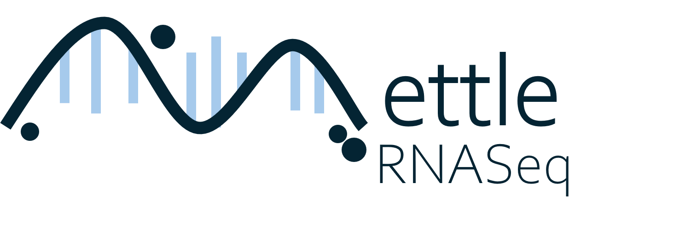

# MettleRNASeq

MettleRNASeq is an R package for exploring **RNA-seq data with small sample
sizes, high variability and complex biological conditions**. It helps prioritize
candidate genes and gene sets for follow-up analysis and explore how gene
relationships differ across experimental conditions.

PCA selects genes by their contribution to expression variation; classification
evaluates resampled gene sets for distinguishing conditions. Correlations and
association rules then explore relationships among the selected genes. The
workflow returns gene lists, scores, tables and plots to support hypothesis
generation.

## Install

Requires R >= 4.2.0.

```r
install.packages(c("BiocManager", "remotes", "randomForest"))
BiocManager::install(c("edgeR", "DESeq2"), ask = FALSE, update = FALSE)
remotes::install_github("SamellaSalles/MettleRNASeq", build_vignettes = FALSE)
library(MettleRNASeq)
```

## Try it

```r
source(system.file("examples", "run_example.R", package = "MettleRNASeq"))
result <- run_mettle_example("bone", output_dir = "example_results")
```

The example includes a normalized [expression matrix](inst/extdata/bone_expression.csv)
and [sample metadata](inst/extdata/bone_metadata.csv). It saves tables, plots
and results in `example_results`.

## Use your data

Start with an expression matrix: **samples in rows, genes in columns**, unique
names and matching sample-condition metadata. Normalize raw counts once;
skip normalization for already normalized data. Classification requires the
same number of replicates in each condition.

Follow the [manual](docs/MettleRNASeq_step_by_step_manual.html) and
[step-by-step script](inst/examples/step_by_step.R) to load your data, run each
function and choose normalization, gene-selection, classification and rule-mining
parameters. Download the manual with **Download raw file** and open it in a browser.
For function help, use `?normalize_count_matrix` or the relevant function name.

## Support and citation

[Report an issue](https://github.com/SamellaSalles/MettleRNASeq/issues) with a
small example and `sessionInfo()`. Use `citation("MettleRNASeq")` to cite the package.
[Method and research examples](https://doi.org/10.1101/2025.05.06.652387) ·
[Example data and processing](inst/extdata/PROVENANCE.md) · [GPL-2.0-or-later](COPYING).

## Author and acknowledgements

**Author and maintainer:** Samella Salles.

Otávio Brustolini, Luciane Ciapina and Kary Ocaña provided research supervision.

Historical support from LNCC and CAPES, and discussions with Rebecca Salles, are acknowledged.
